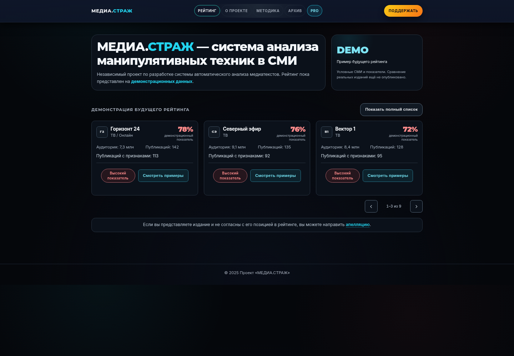

# Рейтинг МЕДИА.СТРАЖ — проект для согласования

Это отдельный предпросмотр `index.html`. Рабочая главная страница не заменена.
Шапка, навигация, общий фон и существующие пути перехода сохранены.

## Посмотреть до / после

[Компьютер: сравнение](screens/comparison-1440.png) ·
[Телефон: сравнение](screens/comparison-390.png)



[Новый вариант на телефоне](screens/after-390.png) ·
[Полный список и переход к анализу](screens/full-list-390.png)

## Что предлагается

| Было | Предлагается | Причина |
|---|---|---|
| Многослойные синие градиенты карточек | Согласованная с анализом графитовая палитра | Единый вид продукта |
| Растущий условный счётчик сигналов | Статичная, заметная пометка DEMO | Демонстрация не выглядит действующим мониторингом |
| Декоративные графики без измеренной динамики | Карточки с названием и понятными показателями | Больше внимания содержимому |
| Автоматическая смена карточек и маленькие точки | Ручные стрелки и счётчик позиции | Чтение не прерывается; скрытые карточки недоступны через Tab |
| Полный список с поиском и сортировкой | Сохранён, улучшен фокус в диалоге | Доступность без изменения маршрута |

Имена девяти условных СМИ, показатели и уровни взяты из существующей демонстрации.
Это **не рейтинг реальных изданий** и не новая оценка точности алгоритма.
Ссылка на публикации и самостоятельную проверку остаётся внизу полного списка.
Дополнительный пункт «Анализ публикаций» в шапку не добавляется.

Подробнее: [проект раздела](rating/PROPOSAL.md).

## Интерактивный предпросмотр

1. [Откройте ветку в Codespaces](https://codespaces.new/artemsmakov1997-debug/media.srtrazh?ref=design%2Frating-preview-v1).
   Нужна ветка `design/rating-preview-v1`.
2. В терминале из корня проекта:

   ```sh
   python3 design-preview/serve.py --bind 0.0.0.0 --port 8000
   ```

3. **Порты → 8000 → Открыть в браузере**. Порт можно оставить приватным.
4. Сверху — **До**, **После**, **Рядом**, **Телефон**. Можно переключать карточки,
   открыть полный список, проверить поиск и сортировку, перейти к анализу.

Свой сервер не нужен. Рейтинг работает на демонстрационном наборе из самого
`index.html`. Для перехода к анализу включена закреплённая публичная подборка за
23 октября 2026 года; это не текущая лента. Ручной анализ использует существующий
проверенный Pyodide; при первом запуске сервера он может загрузиться из npm с
проверкой контрольных сумм, как в рабочем проекте. Установщики Skills не запускаются.

Шрифты с кириллицей включены локально с лицензиями OFL. Варианты «До» и «После»
используют одинаковые шрифты. Favicon сохраняется из актуального main.

## Проверки

- Девять ширин 320–1440 px; сохранность шапки и общего фона, отсутствие горизонтального переполнения.
- Все девять карточек доступны в исходном порядке; автоматического перелистывания нет.
- Скрытые карточки исключены из клавиатурного фокуса и дерева доступности.
- Поиск, сортировка, пустой результат, фокус внутри диалога и возврат на исходную кнопку.
- Переход к `analysis.html` сохраняется внизу полного списка.

[Результаты браузерной проверки](screens/checks.json). Проверка в Chromium;
физические телефоны и Safari пока не проверялись. CI проверяет только предпросмотр
и ничего не публикует. Изменения этого проекта не переносились в рабочий `index.html`.
