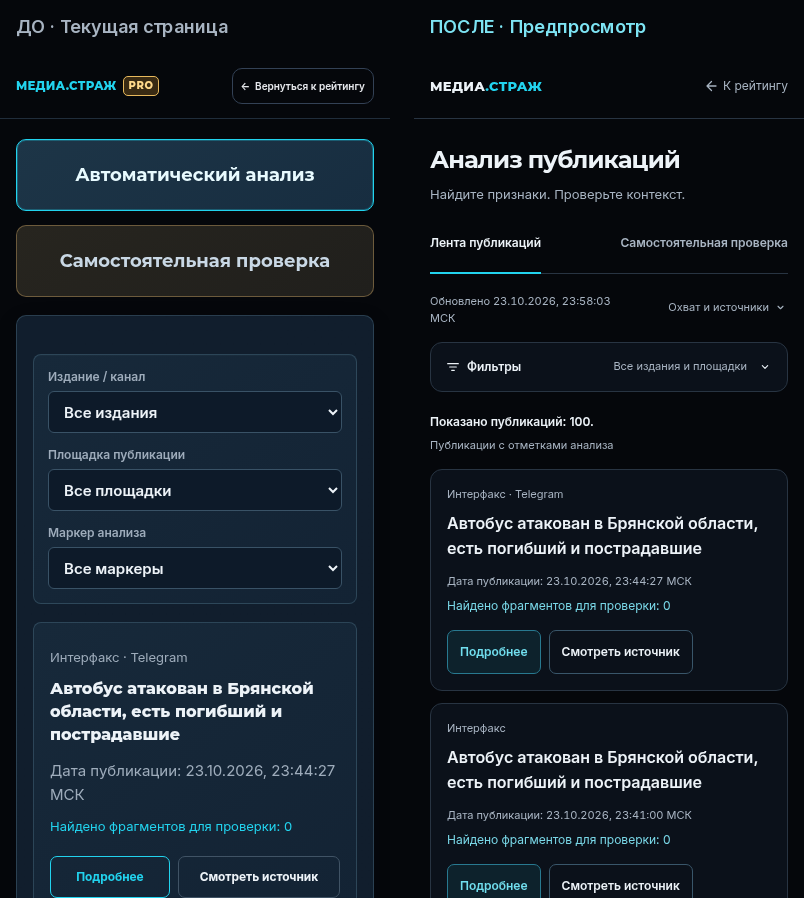
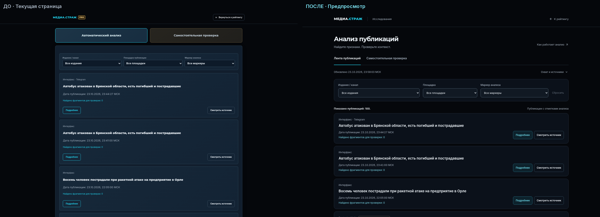

# МЕДИА.СТРАЖ — отдельный предпросмотр анализа

Это вариант для оценки дизайна. `index.html`, `analysis.html`, остальные рабочие
страницы, исходные CSS/JS, Python-анализатор и публикация сайта не изменены.
Все добавления находятся в этой папке и отдельном workflow проверки.

## Посмотреть до / после сразу

### Телефон



[До, крупно](screens/before-390.png) · [После, крупно](screens/after-390.png)

### Компьютер



[До, крупно](screens/before-1440.png) · [После, крупно](screens/after-1440.png)

### Самостоятельная проверка

[Ввод текста, компьютер](screens/manual-input-1440.png) ·
[Подсветка результата, компьютер](screens/manual-result-1440.png) ·
[Подсветка и пояснение, телефон](screens/manual-result-390.png)

## Открыть работающие страницы в браузере

1. Создайте Codespace именно для ветки `design/analysis-preview-v1`:
   [открыть выбранную ветку в Codespaces](https://codespaces.new/artemsmakov1997-debug/media.srtrazh?ref=design%2Fanalysis-preview-v1).
   Проверьте имя ветки на странице создания. Если используете существующий Codespace,
   сначала сохраните свои изменения, затем переключитесь на эту ветку.
2. В терминале из корня проекта запустите:

   ```sh
   python3 design-preview/serve.py --bind 0.0.0.0 --port 8000
   ```

3. Внизу Codespaces откройте вкладку **Порты**, найдите **8000** и нажмите значок
   **Открыть в браузере**. Порт можно оставить приватным. При необходимости добавьте его
   кнопкой «Перенаправить порт».
4. Откроется сравнение с кнопками **До**, **После**, **Рядом** и **Телефон**.
   «Рядом» доступно на широком экране. Для полного рабочего экрана используйте
   **Открыть отдельно**. Обе страницы интерактивны: фильтры, разбор публикации,
   ручной ввод, подсветка, редактирование и JSON-экспорт.

Свой платный сервер не нужен. При первом запуске может потребоваться загрузка
закреплённого Pyodide из npm; существующий код проекта проверяет SHA-512 архива
и контрольные суммы файлов. Никакие установщики Skills не используются.
В уже настроенной среде движок используется повторно.

Страницу со сравнением нельзя запускать двойным кликом по HTML: браузерному
анализатору нужен HTTP-адрес. Команда выше предоставляет его локально в Codespaces.
Адрес `127.0.0.1` из лога облачной среды не является публичной ссылкой на ваш компьютер.

## Что изменено в варианте «После»

| До | После | Зачем |
|---|---|---|
| Две высокие панели выбора режима | Компактные переключатели | Быстрее добраться до публикаций и формы |
| Скрытые сведения об обновлении и выборке | Видимая дата, счётчик и раскрываемый охват | Понятны возраст и границы данных |
| Три поля всегда занимают место на телефоне | Сворачиваемые фильтры и сброс | Больше места для чтения |
| Уменьшение всего интерфейса до 80% | Нормальный масштаб и согласованная типографика | Читаемый текст и управление |
| Длинная лента целиком | Порции по 12 с «Показать ещё» | Удобнее ориентироваться; фильтрация всей подборки сохраняется |
| Разные декоративные панели | Спокойные поверхности, единые кнопки и подсказки | Иерархия строится вокруг текста и доказательств |

Фон `#05070b` и циан сохранены. Новых библиотек интерфейса нет.
Все вычисления выполняет неизменённый Python-анализатор через исходный worker.
Обе обязательные оговорки остаются после ручного результата.

## Как обеспечено честное сравнение

- `before.html` — копия `analysis.html` из `main` на `93fae5955441`.
  Отличаются только базовый адрес ресурсов, `noindex` и локальная доставка тех же семейств шрифтов.
- Обе версии используют одну опубликованную подборку `snapshot.json`:
  100 публикаций, обновление **23 октября 2026, 23:58:03 МСК**, `rules-0.8.2`.
  Это закреплённые данные для сравнения, а не текущая постоянно обновляемая лента.
- Публичные публикации/краткие фрагменты уже присутствовали в общедоступном JSON сайта.
  База сбора, закрытый корпус, токены и введённые пользователем тексты сюда не включены.
- Файлы шрифтов с кириллицей включены с лицензиями OFL; для просмотра не требуется Google Fonts CDN.
- Изменения не подключены ни к одной рабочей странице. Сборка рабочего сайта не копирует
  вложенную папку `design-preview`. Новый CI ничего не развёртывает.

## Проверки

- 287 unit-тестов приложения.
- Существующий браузерный набор, включая совпадение Python/Wasm.
- Отдельная проверка предпросмотра: девять ширин 320–1440 px, отсутствие горизонтального
  переполнения, те же результаты фильтров, сброс, выдача порциями, диалог и возврат фокуса,
  точное совпадение ручного JSON с Python, редактирование, очистка, касание подсказки,
  обе оговорки, reduced motion и переключатели «До / После».
- В автоматическом сценарии предпросмотр не делает внешних запросов;
  введённый текст не отправляется по сети.

Измерения первоначальной локальной проверки: [screens/checks.json](screens/checks.json).
Это эмуляция в Chromium; физические телефоны и Safari пока не проверялись.
Свежие результаты CI видны в workflow **Check isolated analysis design preview**.

Повторить проверку:

```sh
python3 -m unittest discover -s tests -q
python3 -m media_strazh prepare-browser
python3 design-preview/check_preview.py --output /tmp/design-preview-checks
```

Для последних команд нужны Playwright и Chromium — те же инструменты, что использует
существующий браузерный набор проекта. Сервер предпросмотра использует стандартный Python.

После оценки этот вариант можно поправить или отклонить, не меняя рабочий сайт.
Merge в main не выполнялся.
